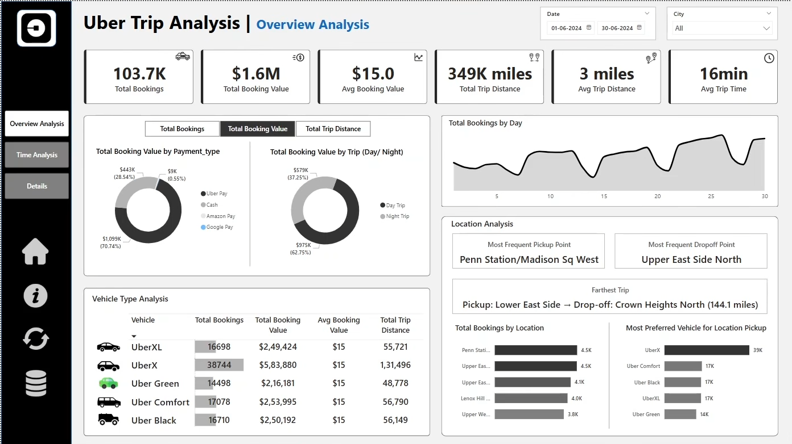
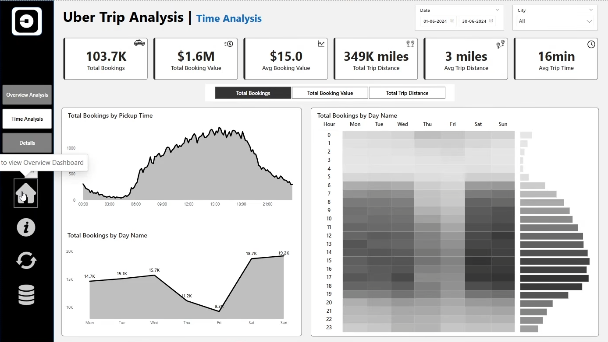
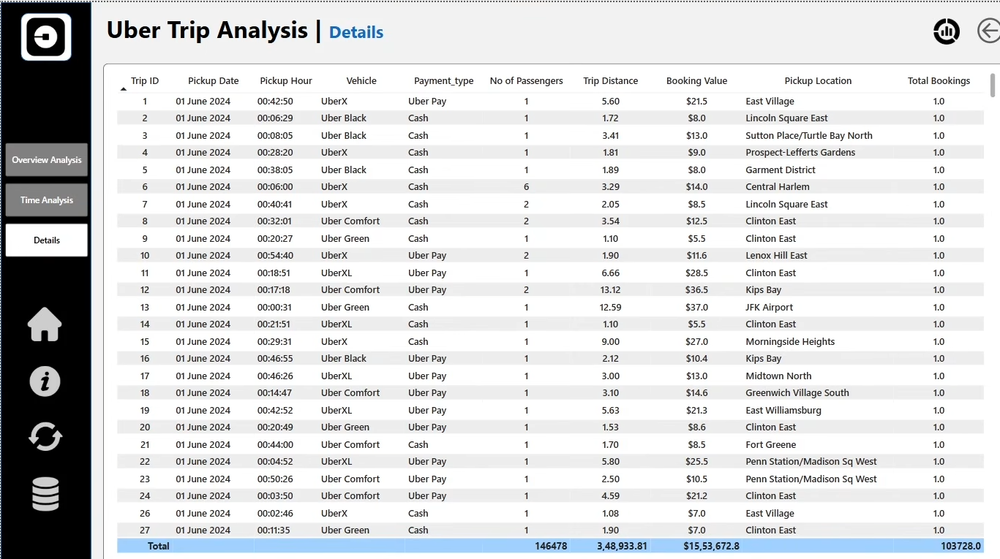

# Uber-Trip-Analysis-Powerbi
Power BI dashboard analyzing 103.7K Uber trips (June 2024): bookings, revenue, vehicle mix, pickup locations, and hourly demand, with DAX measure selector and drill-through.

